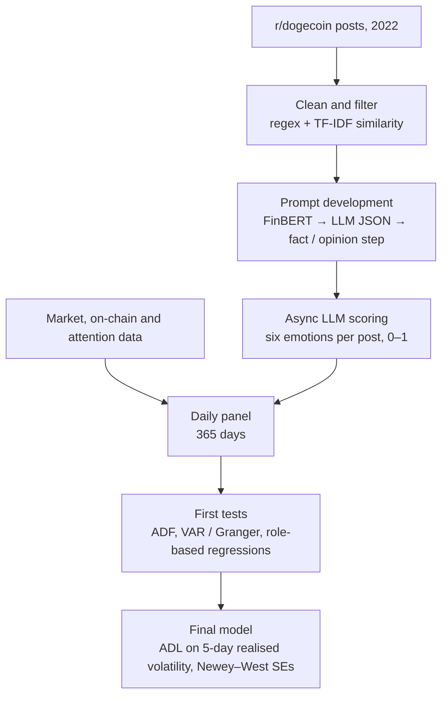

# Fear Moves Memecoins

Code for my undergraduate final-year project at The Hong Kong Polytechnic University (BBA Accounting and Finance, 2026). The question: **do the emotions in Reddit posts predict Dogecoin's volatility?**

Most studies give each post one positive-or-negative score. Here, an LLM (DeepSeek V3.2) scores about 57,000 r/dogecoin posts from 2022 on six separate emotions: joy, trust, fear, surprise, sadness and anger. The prompt is built on the Appraisal Tendency Framework, so each emotion is described by the trading behaviour it tends to cause, such as fear leading to panic selling. The daily emotion series are then tested against 5-day realised volatility in an autoregressive distributed lag (ADL) model with Newey–West standard errors.

**Main finding:** fear is the only emotion that predicts short-term volatility, and its effect is larger than that of joy or sadness. A single negative-sentiment score would have mixed fear with sadness and anger, which show no effect.

This was a three-person group project. I wrote the code in this repository. The paper is available on request.

## Pipeline



## What's in the repo

| Step | File | What it does |
|---|---|---|
| 1 | [`notebooks/01_data_cleaning_and_filtering.ipynb`](notebooks/01_data_cleaning_and_filtering.ipynb) | Removes duplicates and empty posts; keeps on-topic posts with a keyword filter plus TF-IDF cosine similarity against reference sentences; first DeepSeek scoring runs |
| 2 | [`notebooks/02_sentiment_model_iterations.ipynb`](notebooks/02_sentiment_model_iterations.ipynb) | Prompt development on a small $WIF sample: FinBERT baseline → LLM JSON scoring → a fact / opinion / question step so plain facts aren't scored as emotion (exploratory) |
| 3 | [`notebooks/03_async_labeling_pipeline.ipynb`](notebooks/03_async_labeling_pipeline.ipynb) | Async scoring with a concurrency limit, retries and resume-after-interruption; first full pass with role tags → `data/Doge_Sentiment_Master.csv` |
| 3b | [`scripts/score_emotions_atf.py`](scripts/score_emotions_atf.py) | The final scoring prompt used in the paper (Appraisal Tendency Framework), with retries and resume |
| 4 | [`notebooks/04_market_data_and_merge.ipynb`](notebooks/04_market_data_and_merge.ipynb) | Builds the daily market panel and merges it with sentiment; descriptive statistics, a BTC-control check and early figures |
| 5 | [`notebooks/05_feature_engineering_and_econometrics.ipynb`](notebooks/05_feature_engineering_and_econometrics.ipynb) | Daily panel by poster role; ADF tests, VAR / Granger causality and role-based regressions. This earlier analysis led to the final design → `data/Master_Final.csv` |
| 6 | [`notebooks/06_final_adl_model.ipynb`](notebooks/06_final_adl_model.ipynb) | The paper's final ADL specification and hypothesis tests, compared side by side with the paper |

Notebooks 01–05 are the working notebooks from the project, cleaned up but not rewritten. Some cells read intermediate files that aren't included. Notebook 06 runs end to end from `data/`.

## Data

| File | Contents |
|---|---|
| `data/Doge_Sentiment_Master.csv` | 56,799 posts: ID, role tag, six emotion scores (0–1), timestamp. No post text |
| `data/Quant.csv` | Daily DOGE price, volume, on-chain activity and volatility, 2022 |
| `data/Master_Final.csv` | Merged daily panel: 365 days × 43 variables |

Details and sources are in [`data/README.md`](data/README.md). The raw post text isn't included because it belongs to Reddit users.

## Reproducing the final model

The paper's emotion scores come from the final prompt (`scripts/score_emotions_atf.py`) and are weighted by each post's upvotes. Notebook 06 uses the scores from the first full pass, with every post weighted equally. Against the paper's equal-weighted column (Table 3, column 3), it gives:

| | Paper | This repo |
|---|---|---|
| Lagged volatility | 0.712*** | 0.712*** |
| Fear (two-day average) | 0.121* | 0.117* |
| Log volume | 0.007*** | 0.007*** |
| Musk tweet dummy | −0.007** | −0.007** |
| N / R² | 363 / 0.782 | 363 / 0.779 |

The other five emotions are insignificant in both. The paper's robustness and regime tests use the upvote-weighted scores, so they aren't repeated here.

## Running it

```bash
pip install -r requirements.txt
export DEEPSEEK_API_KEY=...          # only needed for the scoring steps
jupyter notebook notebooks/06_final_adl_model.ipynb
```
